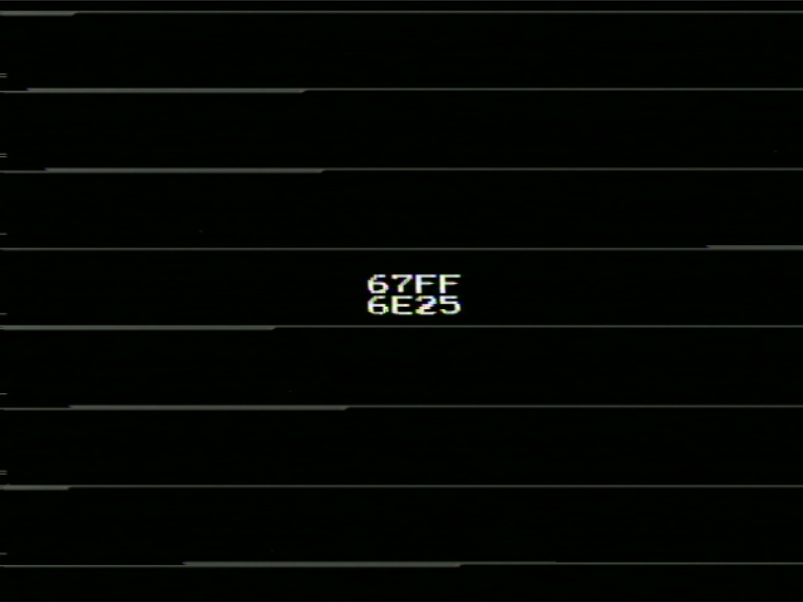

# FDS $4030.D1 Address

This program tests/visualises the FDS' DRAM refresh watchdog IRQ reported by $4030.D1.

## Usage

Simply load the program into an FDS, whether it be original hardware or on an emulator. 

Note: This program uses CHR data loaded by the BIOS ROM on startup. Unofficial BIOS ROM replacements may not guarantee that sensible text characters have been loaded into CHR-RAM beforehand.

### Interface

This program uses a NOPslide starting from $6000 to count the number of cycles between watchdog IRQs:

- First NOPslide return address after resetting the watchdog ($4023.D0 toggle)
- Second NOPslide return address after ack'ing the first IRQ and calling Delay131
- Raster display of Delay131 execution for each watchdog IRQ, while delay routines alternate between the BIOS ROM and PRG-RAM/DRAM

If the watchdog IRQs are not present/emulated, the return addresses will be displayed as `XXXX`.

## Building

The CC65 toolchain is required to build the program: https://cc65.github.io/
A simple `make` should then work.

## Acknowledgements

- Hardware testing was done using a Sharp Twin Famicom + [FDSKey](https://github.com/ClusterM/fdskey).
- The NESdev Wiki, Forums, and Discord have been a massive help. In particular, thanks to: 
  - SCSR, for analysing the 2C33 die scan and discovering this behaviour.
  - Yuri213212, for making the observations around one year ago.
  - paulb_nl, for deducing the watchdog behaviour from earlier versons of this program.
  - Fiskbit, forple, lidnariq, and other members whom I've discussed with while researching the FDS.

